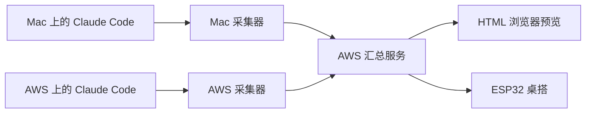

# Claude 桌搭数据采集与同步方案

> 历史设计记录，保留当时的方案与判断。当前功能、目录和使用方式以[仓库 README](../../README.md)为准。

本文记录 Claude Code 桌搭的数据采集和同步方案，覆盖 AWS Linux 远程开发、本地 Mac 开发，以及当前 HTML 和未来 ESP32 显示端。

建议在实际运行 Claude Code 的机器上采集数据，由 AWS 汇总后推送给显示端。会话状态主要通过 Hooks 采集，会话名称和 5h、周额度通过 Status Line 获取。Fable 模型额度的数据来源需要单独验证。

本方案整理于 2026 年 10 月 4 日，尚未实现采集和同步。当前主页面中的会话、额度和重置时间均为示例数据。

## 已确定的界面行为

- 当前版本专注 Claude Code，直接展示会话，不设置项目分组。
- 右上角整组状态点是一个入口，每个点对应一个会话，点击后打开全屏会话列表。
- 状态点和列表保持相同顺序，列表显示状态图标和会话主题，长中文及中英混合主题完整换行。
- 主屏小人表示全部会话的整体状态，打开列表不会改变主屏所代表的会话范围。
- 底部使用三列紧凑布局，同时显示 5h、周和 Fable 剩余额度；点击后查看额度详情。
- 每个状态可以配置多个动画，一段完整播放后接下一段，依次循环；离线和出错也保持动作。

## 系统架构

Mac 和 AWS 各运行一个采集器，只负责本机上的 Claude Code 会话。AWS 汇总服务维护会话状态和账号额度，并向显示端提供统一的数据快照。

通过 SSH 在 AWS 开发时，采集器也运行在 AWS。Mac 休眠或 SSH 连接关闭后，只要远程 Claude Code 仍在运行，远程采集就可以继续。

显示端通过 Wi-Fi 访问汇总服务，只接收状态、标题和额度等显示所需字段。会话事件的判断、合并和数据来源适配都放在采集器及汇总服务中。

## 会话状态采集

Claude Code 官方提供会话开始、用户提交消息、工具调用、权限请求、响应结束和会话退出等 Hooks。下表是拟采用的状态映射，需要在实际使用的 Claude Code 版本上验证。[官方 Hooks 文档](https://code.claude.com/docs/en/hooks)

| 采集信号 | 拟展示状态 | 处理方式 |
| --- | --- | --- |
| `SessionStart` | 空闲或恢复后的已知状态 | 注册会话；仅开始会话不代表已经工作 |
| `UserPromptSubmit`、普通工具的 `PreToolUse` | 工作中 | 标记本轮开始或继续执行 |
| `PermissionRequest`、需要输入的通知 | 等待输入 | 等待授权或用户回应 |
| `AskUserQuestion` 等交互工具开始执行 | 等待输入 | 按工具类型识别，不归入普通工作状态 |
| 后续工具执行或新的用户消息 | 工作中 | 根据后续事件解除等待状态 |
| `Stop` | 本轮完成 | 核对后台任务和继续执行情况后更新 |
| `SessionEnd` | 已停止 | 标记会话退出，保留最近状态供查看 |
| `StopFailure` | 出错或额度限制 | 根据本轮终止原因更新 |

`Stop` 表示主代理结束本轮响应，不保证用户要求的整个任务已经完成；用户手动中断也不会触发该事件。单次工具失败后，Claude 可能继续修复，因此不能把每次工具失败都当作整个会话失败。手动中断、进程异常退出和后台任务仍在运行的情况，需要补充验证及检测。[官方事件语义](https://code.claude.com/docs/en/hooks#stop)

子代理的事件应归入所属会话，避免每个子代理都变成屏幕上的新会话点，也避免子代理结束覆盖仍在工作的主会话状态。

建议将采集 Hooks 安装在每台机器的用户级设置中，覆盖不同目录里的会话。Hooks 只把必要字段写入本地队列或交给本机采集器，采集器异步上传，不让远端网络等待拖慢 Claude Code。

## 会话主题采集

Status Line 的输入包含 `session_id` 和可选的 `session_name`。会话名称可以来自用户自定义名称，也可以来自 Claude 自动生成的标题；没有名称时，该字段可能不存在。[官方 Status Line 文档](https://code.claude.com/docs/en/statusline)

建议优先使用该名称。名称尚未生成时，先显示“新会话”，再尝试使用首条用户消息的本地短摘要，之后更新为正式名称。无需为了生成桌搭标题额外调用模型。

只同步显示所需的主题，不上传完整聊天记录、代码或工具参数。机器来源在内部用于识别和去重，主屏不显示 AWS 或 Mac 标签。

## 额度采集

Status Line 当前文档列出了 5h 和 7 天额度的已用百分比与重置时间。字段是否出现取决于登录方式、账号方案和响应状态，接入前需要验证实际输入。[官方额度字段说明](https://code.claude.com/docs/en/statusline#available-data)

| 主屏列 | 计划读取的字段 | 显示规则 |
| --- | --- | --- |
| 5H | `rate_limits.five_hour` | 剩余比例为 100 减去已用比例 |
| WEEK | `rate_limits.seven_day` | 同上，并保留重置时间 |
| FABLE | 待验证 | 没有可靠来源时显示 `--` |

同一账号在 Mac、AWS 和多个会话上产生的额度快照应归入同一账号记录。采用较新的有效快照，不能把不同会话的额度百分比相加。

额度缺失与额度用完必须区分：没有数据用空值表示，剩余 0% 才表示用完。每项额度保存独立的更新时间，断线时可以保留最后数据并标记过期；重置时间到达后应等待新的有效数据，不能直接假定恢复到 100%。

### Fable 数据来源

当前官方 Status Line 文档未列出模型专属周额度。官方仓库中的用户报告也指出，`/usage` 能显示 Fable，但 Status Line 没有传出对应字段；该报告是用户观察，并非官方接口保证。[相关问题记录](https://github.com/anthropics/claude-code/issues/91920)

应先验证用户实际版本和账号的数据，再决定是否需要独立适配器。

2026 年 10 月 5 日更新：已找到来源。Claude Code SDK 的 `get_usage` 控制请求返回 `rate_limits.model_scoped`，其中 `display_name` 为 `Fable` 的一项就是 Fable 周额度。采集端现在通过这个请求读取全部额度并上报给 Hub，不再使用 Status Line，详见 [HUB_DESIGN.md](HUB_DESIGN.md)。不能用上下文占用、token 数或模型费用推算 Fable 的订阅额度百分比，也不能将通用 API 限流指标替代订阅额度。

## 采集器与汇总服务同步

建议第一版使用 HTTPS 上传和 WebSocket 推送。以下为拟定参数，不是已确认的性能保证。

| 环节 | 建议方式 |
| --- | --- |
| 会话状态事件 | 发生后尽快上传；密集重复事件短暂合并 |
| 额度与标题 | 接收到新的有效 Status Line 数据后更新 |
| 采集器心跳 | 每 10 秒一次，证明采集器连接仍正常 |
| 采集器失联 | 连续约 30 秒未收到心跳后标记来源数据过期 |
| 显示端连接 | WebSocket 接收更新，连接或重连时获取完整快照 |
| 上传失败 | 本地暂存，按递增等待时间重试 |

事件应带有事件标识和来源内的递增序号。汇总服务去重并处理乱序，避免断线重试时旧事件把新状态覆盖。采集器重新连接后，应补发当前快照，不只重放历史事件。

采集器心跳、会话活动和桌搭连接是不同概念。长时间没有新工具事件可能是在思考、执行长任务或等待输入，不能仅因安静就判定会话已停止。采集器失联也不等于其会话正常退出。

上传和读取使用独立的设备凭证，经 HTTPS 传输。ESP32 只保存访问汇总服务所需的凭证，不保存 Claude 登录凭证。

## 显示端数据协议

建议 HTML 与 ESP32 消费同一份小型 JSON 快照，包含以下内容。

| 数据 | 必要字段 |
| --- | --- |
| 快照 | 协议版本、快照版本、汇总时间 |
| 会话 | 会话标识、主题、状态、状态更新时间、数据是否过期 |
| 额度 | 账号标识、额度类型、剩余比例、重置时间、采集时间、数据是否可用 |
| 整体状态 | 汇总后的主屏状态 |

机器标识和账号标识可由配置分配。会话去重使用来源机器标识及 Claude 会话 ID；跨机器恢复同一会话是否合并，需要结合实际使用方式再确定。

主屏整体状态由汇总服务统一计算。建议优先呈现需要用户处理的等待或出错状态，其次是工作中；仍有活动会话时，单个会话完成不触发整体庆祝。所有本轮活动会话都完成后才进入完成动画。过期数据作为单独属性处理，避免一台机器失联覆盖另一台机器仍在工作的事实。

当前 HTML 的布局用于浏览器预览。ESP32 后续通过设备端 UI 实现同样的布局和动画，不依赖浏览器页面；复用的是数据协议和状态规则。

## 分阶段实施

1. 在 AWS 和 Mac 验证实际 Claude Code 版本、登录方式、Hooks 事件及 Status Line 输入，确认可用字段。
2. 实现本机采集器和 AWS 汇总服务，让当前 `index.html` 接收真实的会话主题、状态及 5h、周额度。
3. 验证多会话等待与恢复、正常完成、手动中断、异常退出、SSH 断开、采集器失联和重连恢复。
4. 单独验证并接入 Fable 额度；无法读取时保持 `--`，不使用示例值冒充真实额度。
5. 在确定开发板型号和显示驱动后，让 ESP32 接收同一协议，完成显示、触摸列表及动画播放。

## 接入前待确认

- 使用 Claude 订阅登录还是 API Key，以及订阅方案。
- Mac 和 AWS 是否使用同一个 Claude 账号。
- 两台机器实际安装的 Claude Code 版本，以及是否已有自定义 Status Line，需要兼容保留。
- Fable 在实际账号中的额度字段、含义和可靠读取方式。
- 手动中断与后台任务的状态判定方式，以及已退出会话在列表中保留多久。

目前这些问题尚未确认。架构和字段可先按本方案讨论，具体接入以实际采集结果为准。
