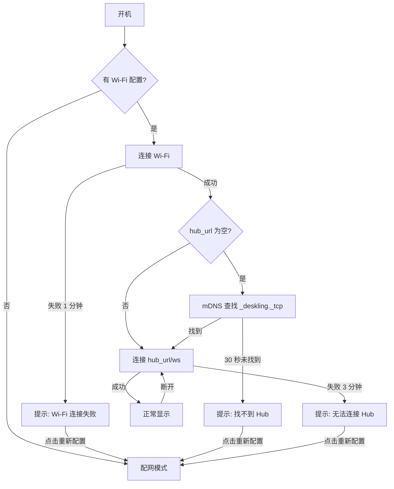

# Deskling Hub 设计

> 历史设计记录，保留当时的方案与判断。当前功能、目录和使用方式以[仓库 README](../../README.md)为准。

本文是 [DATA_SYNC_PLAN.md](DATA_SYNC_PLAN.md) 的落地设计，描述第一版服务端、采集端和显示协议。整理于 2026 年 10 月 5 日。v1 的 Hub、模拟器、采集端和网页实时模式已经实现，使用方法见 [README.md](../../README.md)。

## 部署阶段

| 阶段 | Hub 位置 | 采集端 | 显示端 |
| --- | --- | --- | --- |
| v1 | Mac 本机，监听局域网 | Mac 上的 Claude Code | 浏览器访问 Mac 局域网地址 |
| v2 | AWS，Docker 镜像；推荐前置 HTTPS，也可直接用 HTTP | Mac 和 AWS 都上报到 AWS | 浏览器和 ESP32 通过 WSS 或 WS 连接 |

v1 就按 v2 的方式实现：上报带令牌和事件标识，配置全部来自环境变量，状态保存在数据目录。迁移到 AWS 时，采集端只需修改服务地址和令牌。

## 组成

```
Claude Code ── Hooks ── deskling-hook ──（最多每 30 秒）── deskling-usage → claude get_usage
                            │ 写入本地队列 → POST /ingest            │
                            ▼                                       │ 额度事件
                     deskling-hub（Node 22 + TypeScript） ◀─────────┘
                       · 去重、排序事件
                       · 会话状态机、整体状态、额度合并
                       · GET /snapshot、WebSocket /ws、托管 index.html
                            │
                  浏览器（v1）/ ESP32（硬件到货后）
```

目录规划：

```
hub/         服务端源码、Dockerfile
collector/   Hook 脚本、额度读取脚本、本地发送队列、安装脚本
index.html   显示端页面，改为连接 /ws，保留情景切换作为演示模式
```

## 采集端

### Hook 不阻塞 Claude Code

Hook 以 `"async": true` 注册，在后台运行，Claude Code 不等待它结束。脚本从 stdin 读取事件，提取必要字段，先写入 `~/.deskling/spool/`，再批量 POST 队列中的全部事件，成功后删除。

Hub 不可达时事件留在队列中，下一次任意 Hook 运行时补发。队列最多保留 2000 条。同一时间只有一个进程发送，用锁目录保证；重复发送由 Hub 按 `eventId` 去重。

### 与现有 Hooks 共存

`~/.claude/settings.json` 中已有 iTerm2 的 `cc-status` Hooks。安装脚本只追加 Deskling 的 Hook 项，不修改已有项，并在修改前备份设置文件。卸载脚本只删除 Deskling 自己添加的项。

### 订阅的事件

`SessionStart`、`UserPromptSubmit`、`PreToolUse`、`PostToolUse`、`PostToolUseFailure`、`PermissionRequest`、`Notification`、`Stop`、`StopFailure`、`SessionEnd`。

`SubagentStop` 不改变会话状态，因此不订阅。子代理内的事件带有 `agent_id`，`Stop` 带 `agent_id` 时同样忽略。

### 不使用 Status Line

最初计划用 Status Line 获取会话名称和额度，但实测发现：桌面 App 中的会话不运行 Status Line；终端会话也要在收到回复后才带额度，而且始终没有 Fable 额度。因此改为：

- 会话名称：Hook 在 `SessionStart`、`UserPromptSubmit` 和 `Stop` 时，读取 `transcript_path` 末尾 256KB 中最后一条 `custom-title` 记录，其中包含自定义名称或 AI 生成的标题，`New session` 视为没有标题。
- 额度：由采集端通过 Claude Code 的 `get_usage` 读取，见下一节。

安装脚本不再设置 Status Line；如果检测到旧版安装的 Deskling Status Line，会将其移除。

### 额度读取

额度在采集端所在的机器上读取，Hub 不需要 `claude`，也不接触任何登录信息。

- 每次 Hook 运行时检查距离上次读取是否超过 30 秒（`config.json` 中的 `usageIntervalSec` 可调）。超过时，在锁目录保护下写入时间戳，再启动独立进程 `deskling-usage.mjs`，Hook 本身照常结束。多个 Hook 同时运行，也只会启动一次读取。
- `deskling-usage.mjs` 启动本机 `claude`，发送 SDK 控制请求 `get_usage`（带 `skip_behaviors: true`），读取与 `/usage` 相同的数据。登录由 Claude Code 自己处理；这个请求不调用模型，不消耗额度，约 1 秒返回。查询进程使用 `--setting-sources ''` 和 `--no-session-persistence`，不会触发 Deskling 的 Hooks，也不会留下会话记录。
- 只上报 `five_hour`、`seven_day` 和 `model_scoped` 三项原始数据，额度换算由 Hub 完成。消费额度、充值等其他字段不离开本机。
- `claude` 的绝对路径在安装时写入 `config.json`，因为 Hook 运行时的 `PATH` 可能不完整。找不到 `claude` 的机器只上报会话状态，不上报额度。

因为由 Claude Code 的活动触发，空闲时额度不会更新：在 claude.ai 网页或手机上消耗的额度，要等下一次 Claude Code 有活动时才会显示；到达重置时间后，页面显示“等待刷新”，直到下一次活动。如果以后需要空闲时也更新，可以在本地增加定时任务，Hub 无需修改。

### 上报的字段

| 字段 | 说明 |
| --- | --- |
| `eventId` | 随机 UUID，用于去重 |
| `source` | 机器标识，例如 `mac`、`aws`，由配置指定 |
| `ts` | 采集端毫秒时间，用于同一会话内排序 |
| `sessionId` | Claude 会话 ID |
| `kind` | `hook` 或 `usage` |
| `hook` | Hook 事件名、工具名、通知类型、终止原因、会话标题等少量字段 |
| `usage` | `get_usage` 返回的 `five_hour`、`seven_day`、`model_scoped`；`usage` 事件没有 `sessionId` |

不上传提示词全文、工具参数、代码或文件内容。会话名称缺失时，采集端只上传首条提示词的前 24 个字，作为临时标题；以 `/`、`<`、`!` 开头的输入不作为标题。`SessionStart` 的 `session_title` 和会话记录中的标题优先于临时标题，标题变化时随之更新。

## Hub

### 接口

| 接口 | 用途 | 鉴权 |
| --- | --- | --- |
| `POST /ingest` | 采集端批量上报事件 | `INGEST_TOKEN` |
| `GET /snapshot` | 获取当前完整快照 | `DISPLAY_TOKEN` |
| `GET /ws` | WebSocket；连接后立即发送完整快照，之后每次变化都推送完整快照 | `DISPLAY_TOKEN` |
| `GET /healthz` | 健康检查 | 无 |
| `GET /` | 托管 `index.html` 和 `assets/` | 无 |

整个服务只用一个端口，默认 8787。WebSocket 每 20 秒发送一次 ping。

### 配置

| 环境变量 | 默认值 |
| --- | --- |
| `PORT` | `8787` |
| `HOST` | `0.0.0.0` |
| `DATA_DIR` | `./data`，Docker 中为 `/data` |
| `INGEST_TOKEN`、`DISPLAY_TOKEN` | 必填 |
| `SESSION_RETAIN_MIN` | `30`，失联会话和结束记录的保留时间 |
| `MDNS` | `1`；在局域网广播 `_deskling._tcp`，部署到公网时设为 `0` |
| `LOG_EVENTS` | `0`；设为 `1` 时每收到一个事件打印一行，用于核对 Hook 行为 |
| `SILENT_SUSPECT_MIN` | 待实测，暂定 `10` |

状态定期保存到 `DATA_DIR/state.json`，重启后恢复，避免 Hub 重启后所有会话消失。

### 会话状态机

| 事件 | 新状态 |
| --- | --- |
| `SessionStart` | 新会话为 `idle`；已停止的会话恢复为 `idle`；其他状态保持不变 |
| `UserPromptSubmit`、普通工具的 `PreToolUse`、`PostToolUse` | `working` |
| `PermissionRequest`；`Notification` 中的 `permission_prompt`、`elicitation_dialog`、`elicitation_url_dialog`、`agent_needs_input` | `waiting` |
| `Notification` 中的 `elicitation_complete`、`elicitation_response` | `working` |
| `Notification` 中的 `idle_prompt`，且当前为 `working` | `idle`，推测本轮已被中断，待实测验证 |
| `AskUserQuestion` 等交互工具的 `PreToolUse` | `waiting` |
| `Stop`（不带 `agent_id`） | `done` |
| `StopFailure` | `error_type` 为 `rate_limit` 时记为 `limited`，其他为 `error` |
| `SessionEnd` | 立即从快照中移除 |

补充规则：

- 子代理事件归入所属会话，不新增会话点。
- 同一会话的事件按 `ts` 排序，比当前状态更旧的事件不覆盖新状态。
- 状态为 `working` 时，如果超过 `SILENT_SUSPECT_MIN` 分钟没有任何 Hook 事件，就把 `stale` 标为 `true`，显示端淡化该会话。状态本身不改为完成或停止，因为长时间思考和按 Esc 中断都需要实测后才能区分。
- 收到 `SessionEnd` 后，会话立即从显示上消失。Hub 记下结束时间，并保留 `SESSION_RETAIN_MIN` 分钟：这段时间内早于结束时间的迟到事件一律忽略，避免已结束的会话被并发 Hook 重新带回；结束之后的新事件（例如恢复会话）会让它重新出现。
- `stale` 的会话最后一次上报超过 `SESSION_RETAIN_MIN` 分钟后移除；任何会话 12 小时没有上报也会移除。没有会话的采集端在同样的时间后移出列表。
- 没有 Status Line 心跳后，进程异常退出的会话无法立即识别，只能依靠上面的超时规则清理。

### 整体状态

由 Hub 计算，显示端不重新判断：

1. 有 `waiting` → `waiting`
2. 有 `error` 或 `limited` → `error`
3. 有 `working` → `working`
4. 当前有会话，且本轮活动的会话都是 `done` → `done`。只要有一个会话重新进入 `working`，就开始新的一轮。
5. 有会话但都是 `stopped`（目前只在所有会话都失联时出现）→ `stopped`
6. 没有会话 → `idle`

`stale` 的会话不参与第 1 到 3 步。`offline` 不由 Hub 产生：显示端与 Hub 断开连接时，显示端自己进入 `offline`，并保留最后一次收到的快照。

### 额度

额度来自采集端上报的 `usage` 事件。

| 显示列 | 读取的字段 |
| --- | --- |
| 5H | `rate_limits.five_hour.utilization`、`resets_at` |
| WEEK | `rate_limits.seven_day` |
| FABLE | `rate_limits.model_scoped` 中 `display_name` 为 `Fable` 的一项 |

- 协议说明中标注 `get_usage` 为实验性接口，返回格式可能变化。解析时容错，某一项读不到就显示 `null`；如果以后不可用，再考虑其他来源。
- 剩余比例 = 100 − `utilization`；`resets_at` 是 ISO 时间，转换为 Unix 秒。
- 没有数据时为 `null`，剩余 0 表示用完，两者不能混淆。
- 同一账号可能由 Mac 和 AWS 同时上报，每一项以读取时间最新的为准。
- 读取失败时采集端不上报，Hub 保留上一次的值，`at` 不再更新。
- 到达重置时间后显示"等待刷新"，不自动恢复到 100%。


### 已验证的会话结束行为

2026 年 10 月 5 日在 Claude Code 2.1.286 上实测：

| 操作 | 收到的事件 |
| --- | --- |
| 终端中输入 `/exit` 或按 Ctrl+C 退出 | `SessionEnd`，`reason` 为 `prompt_input_exit` |
| 桌面 App 中归档会话 | `SessionEnd`，`reason` 为 `other`，随后会话进程退出 |
| 桌面 App 中会话回答完后空闲约 4 分钟 | 没有事件，会话进程保持运行 |

因此“已完成但一直开着”的会话不会自动结束，仍会显示为 `done`，直到 12 小时没有任何事件。是否需要为这类会话增加自动淡出，待讨论。

## 显示快照协议

```json
{
  "v": 1,
  "seq": 1042,
  "ts": 1791200000,
  "overall": "waiting",
  "sessions": [
    { "id": "mac:6f2a1c3e-…", "title": "桌搭屏幕布局设计", "state": "waiting", "since": 1791199950, "stale": false }
  ],
  "quota": {
    "5h": { "left": 68, "resetAt": 1791208000, "at": 1791199990 },
    "week": { "left": 42, "resetAt": 1791480000, "at": 1791199990 },
    "fable": null
  },
  "collectors": [{ "source": "mac", "lastSeen": 1791199990 }]
}
```

为 ESP32 预留的约束：

- 整条消息控制在 4KB 以内，最多 12 个会话。
- 标题最多 64 个字符。
- 时间一律为 Unix 秒，倒计时由显示端在本地计算。
- 会话排序由 Hub 决定，网页和 ESP32 按同一顺序显示。
- 会话 `id` 为“机器标识:完整会话 ID”，保证唯一且不变，显示端按它逐个更新状态条，并在会话消失时播放移除动画。
- 状态取值固定为 `working`、`waiting`、`done`、`error`、`limited`、`stopped`、`idle`，新增取值需要升级 `v`。

## 显示端改动

- `index.html` 启动时连接 `/ws`；连接成功后使用真实数据，断开时进入 `offline`，并按递增等待时间重连。
- 原有情景按钮保留，作为演示模式；切换到演示模式后不再使用真实数据。
- 额度重置时间改为根据 `resetAt` 在本地倒计时。
- 顶部左侧显示本地时钟（`HH:MM`），右侧是会话条，会话少时顶部也不显得空。时钟不依赖 Hub：网页用浏览器时间，ESP32 联网后用 SNTP 对时，与 Hub 断开时照常走时。
- 显示令牌第一次通过地址参数 `?token=` 传入，页面保存到浏览器本地存储后，立即从地址栏移除。v2 公网部署时再评估更安全的方式。
- 页面右侧新增“实时数据”入口；点击任一演示情景会切换到演示模式，再点“实时数据”即可切回。

## 显示端配置（ESP32）

Wi-Fi、Hub 地址和显示令牌都不写进固件，而是保存在 ESP32 的 NVS 中，可以在设备上修改。更换 Wi-Fi、IP 或域名都不需要重新烧录。

### 保存的配置

| NVS 键 | 内容 | 说明 |
| --- | --- | --- |
| `wifi_ssid`、`wifi_pass` | Wi-Fi 名称和密码 | 必填 |
| `hub_url` | Hub 地址，例如 `http://192.168.0.107:8787` 或 `https://deck.example.com` | 可以留空，留空时在局域网中自动发现 |
| `display_token` | 显示令牌 | 必填 |

`hub_url` 以 `https://` 开头时用 `wss://` 连接，否则用 `ws://`；WebSocket 路径固定为 `/ws`。两种都必须支持：没有域名或测试时，用户会直接填 `http://<公网 IP>:8787`。

直接使用 HTTP 时，令牌、会话标题和额度都以明文传输，配置页需要提示这一点，但不阻止保存。

### 启动流程



- 断线后按递增等待时间重连，期间显示上次的数据和 `OFFLINE`，与网页一致。
- 三种连接失败的提示页都显示失败原因、当前地址，以及“重新配置”按钮，避免只看到小人一直离线却不知道原因。
- 令牌错误（WebSocket 返回 401）单独提示“令牌无效”，不反复重试。

### 配网模式

1. 设备开启热点 `Deskling-XXXX`（XXXX 为 MAC 地址后四位），热点密码随机生成，与“扫码连接热点”的二维码一起显示在屏幕上。
2. 手机连上热点后自动弹出配置页（captive portal），也可以手动打开 `http://192.168.4.1`。
3. 配置页列出附近的 Wi-Fi 供选择，并填写 Hub 地址（可留空）和显示令牌。
4. 保存后设备尝试连接；成功则重启进入正常显示，失败则回到配置页并显示原因。

进入配网模式的方式：首次开机没有配置时自动进入；正常使用时在设置页长按“重新配置”；连接失败提示页点击“重新配置”。热点在 10 分钟无人操作后关闭，以免长期暴露。

恢复出厂：开机时按住屏幕 5 秒，清空 NVS 中的配置后进入配网模式。

### 局域网自动发现

Hub 通过 mDNS 广播 `_deskling._tcp` 服务，TXT 记录包含 `v`（协议版本）和 `ws`（WebSocket 路径）。设备的 `hub_url` 留空时，按服务类型查找，取第一个 `v` 与固件兼容的结果。Hub 在局域网中更换 IP 后，设备下次连接时会重新查找，不需要修改配置。

Hub 在进程内应答 mDNS，并使用自己的主机名 `deskling-<主机名>.local`，绝不声明电脑本身的主机名。早期版本直接声明了本机主机名，与系统的 mDNS 服务冲突，macOS 因此自动给电脑改名（实际发生过，电脑被改成了 `name-2.local`）。使用独立主机名后，各平台都走同一套实现，广播也随 Hub 进程一起结束，不会在 Hub 崩溃后留下过期的广播。

部署到公网时设置 `MDNS=0`，设备填写域名。服务器 IP 变化时只需更新 DNS 解析。

### 以后可以增加

- 在触摸屏上直接修改 Hub 地址，作为没有手机时的备用方式。
- 配对码：设备显示 6 位配对码，在 Hub 网页上确认后自动下发令牌，免去手动输入令牌。

## 开发顺序

1. 搭建 Hub，加入模拟器脚本，播放多会话事件序列，验证状态机和整体状态。
2. 改造 `index.html`，连接 Hub，跑通模拟数据。
3. 实现采集端和安装脚本，接入本机真实的 Claude Code。
4. 实测 Esc 中断、长时间思考、Mac 休眠和 Hub 重启，调整超时阈值。
5. 编写 Dockerfile，部署到 AWS（推荐前置 HTTPS，也可直接用 HTTP），让 AWS 上的采集端也接入。
6. 硬件到货后，ESP32 实现配网模式和局域网自动发现，接入同一个 `/ws`。

## 待确认

已确认：Mac 和 AWS 使用同一个 Claude 账号，额度合并为一份；不使用 Status Line，额度由采集端在 Claude Code 活动时最多每 30 秒读取一次；已退出会话保留 30 分钟。

仍待确认：

- v2 使用哪个域名和证书方案。
- `idle_prompt` 能否可靠识别 Esc 中断，以及 `SILENT_SUSPECT_MIN` 的合适取值。
